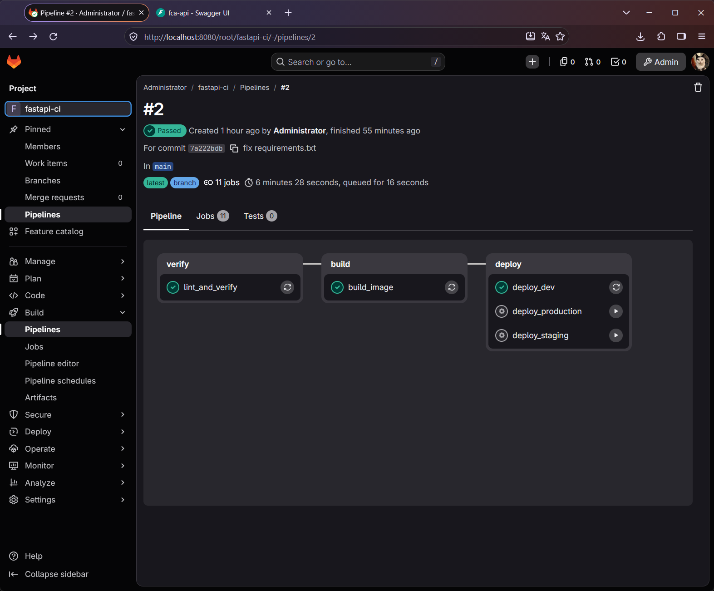
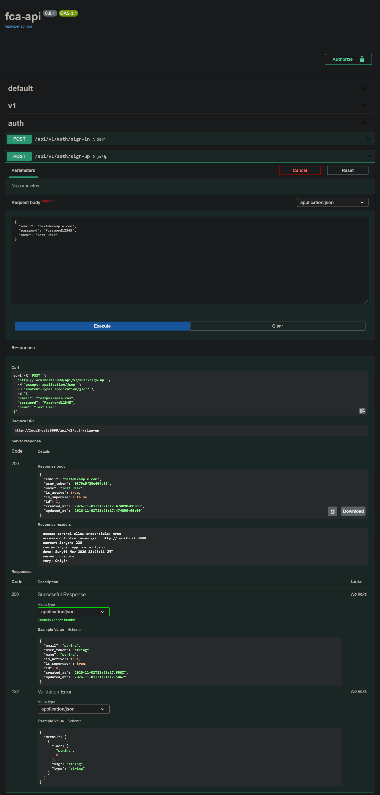
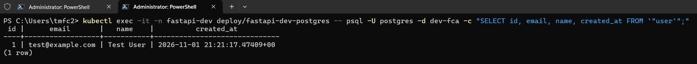

# Инфраструктура и CI/CD для сервиса FastAPI Clean Architecture

Репозиторий содержит решение по контейнеризации и автоматизации доставки FastAPI-сервиса в кластер Kubernetes с помощью GitLab CI и Helm.

## 1. Как пользоваться пайплайном (Инструкция для разработчика)
1. **Разработка фичи:** Создайте новую ветку от `main` (`git checkout -b feature/my-feature`), внесите изменения и отправьте в GitLab.
2. **Открытие Merge Request (MR):** При создании MR в ветку `main` автоматически запускаются стадии `verify` (проверка синтаксиса/линтеры/тесты) и `build` (проверка, что Docker-образ корректно собирается). Если сборка падает — влить MR нельзя.
3. **Деплой в Development:** После ревью и нажатия кнопки **Merge**, обновление ветки `main` автоматически запускает джобу `deploy_dev`, которая накатывает новую версию в Kubernetes-неймспейс `fastapi-dev` через Helm и автоматически прогоняет миграции Alembic.
4. **Продвижение в Staging и Production:** В пайплайне ветки `main` доступны ручные (`manual`) джобы `deploy_staging` и `deploy_production`, позволяющие в один клик выкатить проверенный релиз в соответствующие неймспейсы (`fastapi-staging`, `fastapi-prod`).

## 2. Принятые архитектурные решения и почему
* **Выбор локального стенда (Minikube + GitLab Runner):** Выбрана связка облачного GitLab.com и локального кластера Minikube с локальным GitLab Runner. Это позволяет протестировать полноценный цикл CI/CD без затрат на облачного провайдера. *Ограничение решения:* кластер физически находится на локальной машине и недоступен из публичного интернета, а `PersistentVolume` привязан к одной ноде Minikube. Из-за ограничений облачного GitLab.com для аккаунтов из РФ, CI-контур был развёрнут полностью локально на базе self-hosted gitlab/gitlab-ce + gitlab-runner + Minikube. Все скриншоты работы пайплайна приложены ниже, а сам репозиторий продублирован на GitHub для публичного доступа к коду.

* **Упаковка в Helm-чарт вместо сырых YAML-манифестов:** В ТЗ указано требование готовности к появлению окружений `staging` и `production`. Использование единого Helm-чарта с раздельными файлами значений (`values-dev.yaml`, `values-staging.yaml`, `values-prod.yaml`) и шаблона `.deploy_template` в GitLab CI избавляет от дублирования кода (принцип DRY).
* **Multi-stage Dockerfile и непривилегированный пользователь:** Сборка разделена на два этапа (`builder` с компиляторами и финальный `python:3.10-slim`), что уменьшает размер образа и поверхность атаки. Контейнер запускается от пользователя `appuser`, а не `root`.
* **Учет специфики `app/core/config.py`:** В коде приложения имя базы данных жестко привязано к переменной `ENV` через `ENV_DATABASE_MAPPER` (`dev` -> `dev-fca`, `stage` -> `stage-fca`, `prod` -> `fca`). Эти значения синхронизированы в `values-*.yaml` между переменными приложения и `POSTGRES_DB`.
* **Доступ снаружи кластера:** Настроены как `Service` типа `NodePort`, так и контроллер `Ingress` (Nginx), чтобы обеспечить маршрутизацию трафика по доменным именам окружений.

## 3. Что бы я сделал иначе, если бы было больше времени и ресурсов (Production-ready)
1. **Вынес бы базу данных из Kubernetes:** Сейчас база крутится прямо рядом с приложением. Для реального продакшена надежнее использовать готовую облачную базу данных (Managed PostgreSQL от провайдера). Это снимает головную боль с настройкой резервного копирования и восстановлением после сбоев.
2. **Безопасное хранение паролей:** Сейчас пароли от БД лежат в конфигурационных файлах (values). В реальном проекте я бы настроил безопасное хранилище секретов, чтобы пароли нигде не светились в открытом виде в коде.
3. **Изменил бы запуск миграций БД:** Сейчас миграции запускаются вместе со стартом самого приложения. Если на проде мы запустим сразу 3-5 реплик приложения для распределения нагрузки, они могут начать обновлять базу одновременно и выдадут ошибку. Нужно вынести миграции в отдельный шаг, который выполняется строго до запуска приложения.
4. **Мониторинг и логи:** Добавил бы сбор метрик и логов в единое место, чтобы команда могла видеть графики нагрузки и быстро находить ошибки, если приложение упадет.

## 4. Вопросы, которые я бы задал команде перед внедрением в реальный проект
1. **Нагрузка:** Сколько примерно пользователей ожидается? Это нужно, чтобы понять, сколько оперативной памяти и процессора (limits/requests) нужно выделить приложению, чтобы оно не тормозило.
2. **Тестирование:** Есть ли у разработчиков написанные автотесты? Если да, их нужно добавить в пайплайн на этап Merge Request, чтобы сломанный код даже не доходил до сборки образа.
3. **Бэкапы базы данных:** Как часто мы должны делать резервные копии базы данных и как долго их хранить? 
4. **Управление секретами:** Где в компании принято хранить доступы и токены для продакшен-окружений?

## 5. Демонстрация работы
* **Работа пайплайна GitLab CI:** 
* **Ответ сервиса снаружи кластера (Swagger UI):** 
* **Сохранение данных в PostgreSQL:** 